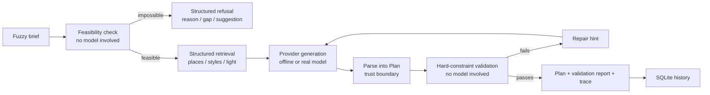

# shotplan

> Turn a vague "I want a Hanfu photoshoot in Xi'an" into an **executable, checkable, traceable** hour-by-hour plan.
> An evaluable agent system, not another chat box.

[中文 README](README.md) ·    

---

## Why this exists

LLMs are excellent at producing plans that *look* beautiful: five outdoor locations in one day, makeup scheduled after the shoot, invented landmark names, double the budget. Impressive in a demo, useless in production.

This project argues something plain: **quality in an AI application must be measurable, not a matter of taste.** So generation is not the finish line. Before generation, a deterministic check decides whether the brief is satisfiable at all. After generation, a validator that does not use any model grades the output against testable rules. A controlled eval suite then proves the measurement actually separates good plans from bad ones.

Hanfu travel photography was chosen because its constraints are real: golden-hour windows, transfer time between sites, makeup before shooting, a hard budget ceiling, weather fallbacks — and a human can judge whether the result makes sense.

| | Common approach | This project |
| --- | --- | --- |
| Output | Free text | Structured `Plan`: time blocks, costs, citations |
| Quality | Try another prompt | 12 deterministic rules + dimension scores |
| Impossible brief | Fabricate a plan anyway | Pre-generation check returns reasons, gaps, suggestions and theoretical minimums |
| Failure handling | Regenerate once | Validation report becomes a repair hint; **worse drafts are rejected** |
| Evidence | Screenshots | 80 regression cases + 200 holdout briefs + real HTTP load test + control group + 13 CI gates |
| Gate validity | "CI is green" | 8 injected mutations must all be caught by the real gate |
| Unseen inputs | One hand-written suite | 200 mined holdout briefs, kept separate so baselines stay comparable |
| Grounding | None | Every location id must exist in the knowledge base |
| Run records | None | Full trace, latency, tokens and estimated cost per run |
| Barrier to entry | Needs an API key | Core is standard-library only; runs right after `git clone` |

## Quick start (no account, network or API key)

```bash
git clone https://github.com/zhaozilong6666/shotplan.git
cd shotplan
python -m shotplan.cli plan
python -m evals.run_eval --write-report
python -m evals.mutation_lab --check    # prove the quality gate itself works
python -m evals.case_miner --check      # holdout set: unseen brief combinations
python -m evals.http_load --check       # real uvicorn service under HTTP load
```

`python -m pip install -e ".[api,dev]"` enables the Web UI and tests; the core engine needs nothing else.

## What happens in one run



Two decisions deliberately sit **outside the model**: whether the request is satisfiable, and whether an output is executable. See [ADR 0002](docs/adr/0002-validator-outside-model.md) and [ADR 0007](docs/adr/0007-feasibility-before-generation.md).

### Impossible briefs

```bash
python -m shotplan.cli plan --budget 100
# [BUDGET_BELOW_MINIMUM] 100 CNY is below the minimum executable cost of 350 CNY
#   Gap: 250 CNY short
#   Suggestion: raise the budget to at least 350 CNY, or use the simplest styling package and a free location
```

Exit code `3`. The API returns HTTP 200 with `status: "infeasible"` and a `feasibility` object; the Web UI renders a dedicated refusal view. Minimums (350 CNY / 1.5 hours) are computed from the knowledge base, not hard-coded.

## Evaluation: an experiment with a control group

Running an eval only against a planner you wrote yourself makes it easy to build a scorer that always returns full marks. So both providers run over **the exact same 80 cases**:

| Metric | Rule agent (`good`) | Control (`naive`) |
| --- | ---: | ---: |
| Hard-constraint pass rate | **100%** | 13.8% |
| Average score | **0.9788** | 0.3014 |
| Cases passed | **80 / 80** | 11 / 80 |

The **0.6774** gap is the point. `naive` deliberately ignores time, transfers, budget, sourcing and invents locations. The gate does more than compare two averages: it requires the control plan to still trigger **each of its known defects** (a rule-level coverage floor), plus a delta floor and control-group ceilings. Otherwise silently deleting one hard rule is invisible — the control plan is so broken that its `constraints` score is already clamped at 0. See [ADR 0009](docs/adr/0009-gate-sensitivity.md).

Cases: `normal` 30, `conflict` 23, `edge` 16, `infeasible` 11. The last group describes briefs that are **mathematically unsatisfiable**; the correct behaviour is a structured refusal, not a fabricated plan. Since feasibility is checked before generation and is provider-independent, both providers share that verdict — differentiation comes from the other 69 cases.

```bash
python -m evals.run_eval --write-report
python -m evals.run_eval --compare evals/baselines/v6-naive.json
python -m evals.mutation_lab --check
python -m evals.case_miner --check
```

The generated [eval report](docs/eval-report.md) is committed, so a reviewer can see the conclusion without running anything — including a concrete "change → score drop → gate rejects → rollback restores" example. See [evaluation methodology](docs/evaluation.md) and [problem & metrics](docs/problem-and-metrics.md).

## Holdout challenge set (unseen briefs)

80/80 green can also mean the rules were tuned against those exact 80 briefs. So the [failure library](docs/failure-gallery.md) and the knowledge base drive a deterministic grid of **225 candidate briefs** (5 cities x 5 styles x 9 pressure profiles x 4 rotating seasons). The miner **never reads any case's expected output**; it only sees brief fingerprints for deduplication. 25 deliberately contradictory briefs are rejected by the pre-generation feasibility check, leaving **200 unseen holdout cases**; city x style coverage goes from 19/25 to **25/25**, good hard-pass 100%, naive 0%, minimum score gap 0.7687. See the [mining report](docs/case-mining.md) and [ADR 0010](docs/adr/0010-holdout-challenge-set.md).

The holdout lives in `evals/challenge/` and is **not** read by `run_eval`: the main suite stays a stable regression baseline so v1-v6 snapshots remain comparable. `python -m evals.case_miner --check` is CI gate #12.

## Real HTTP load test

Every earlier throughput number came from calling Python functions directly. [http-load.md](docs/http-load.md) starts a real `uvicorn` subprocess with 1 / 2 / 4 workers and sends `POST /api/plan` over loopback with httpx, so HTTP parsing, ASGI middleware, full plan+trace JSON serialisation, the network stack and **several OS processes writing the same SQLite file** are all included. Single worker at concurrency 8 reaches about **251/s** with P95 **39.9 ms**; 1000 real requests produced **0 errors and 0 lost writes**.

The interesting finding: adding workers did **not** scale linearly. Four workers reached only **0.52x** the single-worker throughput, because every request writes one run record and WAL allows just one writer at a time — the bottleneck moved from the GIL to shared state. Throughput and latency are reported, never gated (ADR 0008); `--check` asserts only machine-independent contracts and is CI gate #13.

## More verifiable evidence

1. **[Repair-loop experiment](docs/repair-experiment.md)** — three constructed providers over the same 69 satisfiable briefs. A repairable provider goes from 0% to 100% hard-pass in one round (69/69); all 69 "repairs" from a provider that ignores hints are rejected; all 69 worse-than-original repairs are blocked by the monotonic guard. Every accept/reject decision is read from the run trace.
2. **[Failure gallery](docs/failure-gallery.md)** — 517 structured failure records in 4 categories, each with the input brief, observed output fragment, expected rule and repair suggestion. New rules should be backed by a real failure; real-model failures get appended in the same format later.
3. **[Observability dashboard](docs/observability.md)** — `python -m shotplan.cli stats`, `GET /api/stats` and a Web tab aggregate stored runs by provider / prompt version: pass rate, average score, P50/P95 latency, cost, repairs and structured refusals. Data comes from the full SQLite payloads, with no second metrics table.
4. **[Gate-sensitivity lab](docs/mutation-report.md)** — 8 controlled mutations (3 on generation, 5 on validation) are injected in-process, run through the same 80 cases and the real gate, and must all be rejected; every one is rolled back and compared field-by-field. The previous gate caught only **4/8**; the fixed gate catches **8/8**.
5. **Engineering evidence** — [fuzzing](docs/fuzz-report.md) (1000 mutated inputs, 0 crashes), [benchmark](docs/benchmark.md) (p50 ≈0.2 ms), [load test](docs/loadtest.md) (600 concurrent requests, 0 errors / 0 lost writes), [real output examples](docs/examples.md) and [threads vs processes](docs/scaling.md) (1.04× vs 1.72×).

6. **[Holdout challenge set](docs/case-mining.md)** — 225 mined candidates, 200 unseen briefs accepted, 25 infeasible negative controls rejected, coverage 19/25 -> 25/25. Independent of the regression suite so historical baselines stay comparable.

7. **[Real HTTP load test](docs/http-load.md)** — 1/2/4 uvicorn workers, ~251/s at concurrency 8, 1000 requests with 0 errors / 0 lost writes; 4 workers are slower than 1 because of the shared SQLite writer lock.

## Architecture and layout

```
shotplan/
├── src/shotplan/
│   ├── domain/        # Pure data structures, rules, pre-generation feasibility
│   ├── knowledge/     # Curated places / styles + exact retrieval tools
│   ├── agents/        # Providers, versioned prompts v1/v2, parser, validator
│   ├── pipeline.py    # Feasibility → retrieval → generation → parse → validate → repair
│   ├── observability.py # Aggregate run history into a quality dashboard
│   ├── tracing.py     # Latency / tokens / cost / events
│   ├── storage.py     # SQLite run history
│   ├── api.py         # Optional FastAPI layer
│   └── cli.py         # CLI entry point
├── web/               # Dependency-free single-page UI (5 tabs)
├── evals/             # 80 cases + 200 holdout briefs, mutation/mining/HTTP-load labs
├── tests/             # 201 unit tests
└── docs/              # Architecture, metrics, 10 ADRs, ops, interview notes
```

The core uses only the Python standard library; FastAPI / pytest / ruff are optional layers. This makes "runs with no credentials" a design decision, not a compromise.

## Architecture decisions (ADRs)

| # | Decision | Reason |
| --- | --- | --- |
| [0001](docs/adr/0001-core-zero-dependency.md) | Core has no framework dependency | Zero-friction execution; schema validation at the API boundary |
| [0002](docs/adr/0002-validator-outside-model.md) | Validation does not use a model | Quality definitions must stay stable across models and prompts |
| [0003](docs/adr/0003-exact-retrieval-over-vectors.md) | Exact retrieval, not vectors | Tiny KB, exact constraints, every item must be citable |
| [0004](docs/adr/0004-versioned-prompts.md) | Prompts are versioned code | Regressions must be attributable to a specific change |
| [0005](docs/adr/0005-no-frontend-framework.md) | No frontend framework / build step | Spend the complexity budget on agent logic |
| [0006](docs/adr/0006-scoring-determinism.md) | Fixed-precision scores with exact summation | Identical inputs must produce bit-identical scores on Python 3.10–3.13 |
| [0007](docs/adr/0007-feasibility-before-generation.md) | Feasibility before generation | "Can this be done?" is arithmetic, not a model task |
| [0008](docs/adr/0008-fuzz-and-benchmark-gates.md) | Fuzzing and benchmarks as gates | "Never crashes" and "never slow" must be testable, not reviewed by hand |
| [0009](docs/adr/0009-gate-sensitivity.md) | Test the gates themselves with mutations | A green CI run does not prove the checks work |
| [0010](docs/adr/0010-holdout-challenge-set.md) | Keep the holdout challenge set separate | Regression baselines must stay comparable across versions |

## Optional: real model, UI, deployment

```bash
cp .env.example .env
# Set SHOTPLAN_PROVIDER=openai_compatible and add your key (never commit .env)
python -m pip install -e ".[api,dev]"
python -m shotplan.cli serve          # http://127.0.0.1:8000
docker compose up --build
```

Any OpenAI-compatible endpoint works (OpenAI, DeepSeek, local Ollama / vLLM). Without a key everything runs in `mock` mode. Versioned v1/v2 prompts and `--prompt-version` are ready for a real-model comparison experiment.

## Roadmap

- [x] Phases 1–3: domain, knowledge base, validator, pipeline, tracing, API/Web, eval suite, CI gates
- [x] Phase 4 offline work: 80 cases, `INFEASIBLE` branch, repair lab, failure library, prompt v1/v2 framework, cost/latency reporting, gate-sensitivity lab, 200-brief holdout challenge set, real HTTP load test with multiple uvicorn workers
- [ ] Phase 4 remaining: real-model comparison experiments (needs an API key)
- [ ] Phase 5: public online demo, bilingual polish, final resume materials

## Known limitations (stated up front)

- The knowledge base is a small hand-curated sample, not live merchant/pricing data.
- Feasibility minimums (350 CNY / 1.5 h) are theoretical values derived from static data; no real-time prices, closures, weather or availability.
- The offline `good` provider is a **deterministic implementation written against the rules**; its high score is an upper-bound reference, not evidence of model quality.
- Estimated cost is 0 in offline mode; real-model cost/latency comparisons are not yet measured.
- Real booking/payment, authentication and concurrent writes are out of scope. The knowledge base covers five cities (Xi'an, Luoyang, Hangzhou, Suzhou, Nanjing); adding a city means adding data, cases and a baseline together.
- The 8 mutations are hand-picked and prove those specific regressions are caught, not that the gate is infallible.
- The 200 holdout briefs come from a fixed grid (combination diversity, not real customer distribution); they show the judgement chain generalises, not that a real model would score well.
- The HTTP load test is a single-machine loopback sample with no TLS, reverse proxy or real-model latency; two runs on the same machine can differ by nearly 2x for 4 workers, so these numbers are a scale reference, not production QPS.
- Performance and concurrency numbers come from a single machine (concurrency 1/4/8, threads vs processes), not production QPS; the pipeline is synchronous and the API moves it off the event loop with a thread pool.
- Fuzzing proves "any input returns a structured result", not "any input gets a good plan" — quality is still the eval suite's job.

## For interviews

> "I built an evaluable planning agent. The point wasn't calling a model — it was writing 'executable' as 12 testable hard constraints, checking satisfiability *before* generation, grading outputs with a validator that never uses a model, feeding the report back as a repair hint, and refusing worse rewrites. To make quality comparable I built 80 eval cases across five cities plus a deliberately broken control provider. I didn't stop at '80/80 green': I mutation-tested the gate itself with 8 injected faults and found the old gate missed 4 cases where a single validation rule was silently deleted — the control plan is so broken that losing one issue barely moves its score. After adding rule-level coverage, all 8 are caught. I also mined 200 briefs the main suite had never seen, kept in a separate holdout so the historical baselines stay comparable. Finally I ran the real service under load and found that adding workers made it slower because they all contend for one SQLite writer — the bottleneck changes with the architecture layer. A deterministic fuzzer also guarantees no malformed brief can crash the service."

Detailed Q&A: [docs/interview-notes.md](docs/interview-notes.md).

## License

MIT
