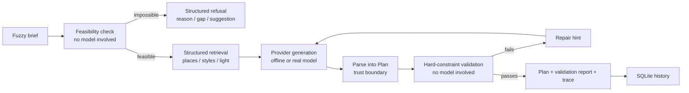

# shotplan

> Turn a vague "I want a Hanfu photoshoot in Xi'an" into an **executable, checkable, traceable** hour-by-hour plan.
> An evaluable agent system, not another chat box.

[中文 README](README.md) ·    

---

## Why this exists

LLMs are excellent at producing plans that *look* beautiful: five outdoor locations in one day, makeup scheduled after the shoot, invented landmark names, double the budget. Impressive in a demo, useless in production.

This project argues something plain: **quality in an AI application must be measurable, not a matter of taste.** So generation is not the finish line. Before generation, a deterministic check decides whether the brief is satisfiable at all. After generation, a validator that does not use any model grades the output against testable rules. A controlled eval suite then proves the measurement actually separates good plans from bad ones.

Hanfu travel photography was chosen because its constraints are real: golden-hour windows, transfer time between sites, makeup before shooting, a hard budget ceiling, weather fallbacks — and a human can judge whether the result makes sense.

| | Common approach | This project |
| --- | --- | --- |
| Output | Free text | Structured `Plan`: time blocks, costs, citations |
| Quality | Try another prompt | 12 deterministic rules + dimension scores |
| Impossible brief | Fabricate a plan anyway | Pre-generation check returns reasons, gaps, suggestions and theoretical minimums |
| Failure handling | Regenerate once | Validation report becomes a repair hint; **worse drafts are rejected** |
| Evidence | Screenshots | 36 eval cases + deliberately flawed control group + CI gates |
| Grounding | None | Every location id must exist in the knowledge base |
| Run records | None | Full trace, latency, tokens and estimated cost per run |
| Barrier to entry | Needs an API key | Core is standard-library only; runs right after `git clone` |

## Quick start (no account, network or API key)

```bash
git clone https://github.com/zhaozilong6666/shotplan.git
cd shotplan
python -m shotplan.cli plan
python -m evals.run_eval --write-report
```

`python -m pip install -e ".[api,dev]"` enables the Web UI and tests; the core engine needs nothing else.

## What happens in one run



Two decisions deliberately sit **outside the model**: whether the request is satisfiable, and whether an output is executable. See [ADR 0002](docs/adr/0002-validator-outside-model.md) and [ADR 0007](docs/adr/0007-feasibility-before-generation.md).

### Impossible briefs

```bash
python -m shotplan.cli plan --budget 100
# [BUDGET_BELOW_MINIMUM] 100 CNY is below the minimum executable cost of 350 CNY
#   Gap: 250 CNY short
#   Suggestion: raise the budget to at least 350 CNY, or use the simplest styling package and a free location
```

Exit code `3`. The API returns HTTP 200 with `status: "infeasible"` and a `feasibility` object; the Web UI renders a dedicated refusal view. Minimums (350 CNY / 1.5 hours) are computed from the knowledge base, not hard-coded.

## Evaluation: an experiment with a control group

Running an eval only against a planner you wrote yourself makes it easy to build a scorer that always returns full marks. So both providers run over **the exact same 60 cases**:

| Metric | Rule agent (`good`) | Control (`naive`) |
| --- | ---: | ---: |
| Hard-constraint pass rate | **100%** | 15.0% |
| Average score | **0.9762** | 0.3115 |
| Cases passed | **60 / 60** | 9 / 60 |

The **0.6647** gap is the point. `naive` deliberately ignores time, transfers, budget, sourcing and invents locations; if it ever scores as high as the planner, CI declares "measurement is broken" and fails.

Cases: `normal` 18, `conflict` 14, `edge` 10, `infeasible` 8. The last group describes briefs that are **mathematically unsatisfiable**; the correct behaviour is a structured refusal, not a fabricated plan. Since feasibility is checked before generation and is provider-independent, both providers share that verdict — differentiation comes from the other 51 cases.

```bash
python -m evals.run_eval --write-report
python -m evals.run_eval --compare evals/baselines/v4-naive.json
python -m evals.run_eval --prompt-version planner-v1
```

The generated [eval report](docs/eval-report.md) is committed, so a reviewer can see the conclusion without running anything. See [evaluation methodology](docs/evaluation.md) and [problem & metrics](docs/problem-and-metrics.md).

## Three extra pieces of evidence

1. **[Repair-loop experiment](docs/repair-experiment.md)** — three constructed providers over the same 51 satisfiable briefs. A repairable provider goes from 0% to 100% hard-pass in one round (51/51); all 51 "repairs" from a provider that ignores hints are rejected; all 51 worse-than-original repairs are blocked by the monotonic guard. Every accept/reject decision is read from the run trace.
2. **[Failure gallery](docs/failure-gallery.md)** — 170 structured failure records in 4 categories, each with the input brief, observed output fragment, expected rule and repair suggestion. New rules should be backed by a real failure; real-model failures get appended in the same format later.
3. **[Observability dashboard](docs/observability.md)** — `python -m shotplan.cli stats`, `GET /api/stats` and a Web tab aggregate stored runs by provider / prompt version: pass rate, average score, P50/P95 latency, cost, repairs and structured refusals. Data comes from the full SQLite payloads, with no second metrics table.

## Architecture and layout

```
shotplan/
├── src/shotplan/
│   ├── domain/        # Pure data structures, rules, pre-generation feasibility
│   ├── knowledge/     # Curated places / styles + exact retrieval tools
│   ├── agents/        # Providers, versioned prompts v1/v2, parser, validator
│   ├── pipeline.py    # Feasibility → retrieval → generation → parse → validate → repair
│   ├── observability.py # Aggregate run history into a quality dashboard
│   ├── tracing.py     # Latency / tokens / cost / events
│   ├── storage.py     # SQLite run history
│   ├── api.py         # Optional FastAPI layer
│   └── cli.py         # CLI entry point
├── web/               # Dependency-free single-page UI (5 tabs)
├── evals/             # 60 cases, scorers, report generator, repair lab, failure library
├── tests/             # 116 unit tests
└── docs/              # Architecture, metrics, 7 ADRs, ops, interview notes
```

The core uses only the Python standard library; FastAPI / pytest / ruff are optional layers. This makes "runs with no credentials" a design decision, not a compromise.

## Architecture decisions (ADRs)

| # | Decision | Reason |
| --- | --- | --- |
| [0001](docs/adr/0001-core-zero-dependency.md) | Core has no framework dependency | Zero-friction execution; schema validation at the API boundary |
| [0002](docs/adr/0002-validator-outside-model.md) | Validation does not use a model | Quality definitions must stay stable across models and prompts |
| [0003](docs/adr/0003-exact-retrieval-over-vectors.md) | Exact retrieval, not vectors | Tiny KB, exact constraints, every item must be citable |
| [0004](docs/adr/0004-versioned-prompts.md) | Prompts are versioned code | Regressions must be attributable to a specific change |
| [0005](docs/adr/0005-no-frontend-framework.md) | No frontend framework / build step | Spend the complexity budget on agent logic |
| [0006](docs/adr/0006-scoring-determinism.md) | Fixed-precision scores with exact summation | Identical inputs must produce bit-identical scores on Python 3.10–3.13 |
| [0007](docs/adr/0007-feasibility-before-generation.md) | Feasibility before generation | "Can this be done?" is arithmetic, not a model task |

## Optional: real model, UI, deployment

```bash
cp .env.example .env
# Set SHOTPLAN_PROVIDER=openai_compatible and add your key (never commit .env)
python -m pip install -e ".[api,dev]"
python -m shotplan.cli serve          # http://127.0.0.1:8000
docker compose up --build
```

Any OpenAI-compatible endpoint works (OpenAI, DeepSeek, local Ollama / vLLM). Without a key everything runs in `mock` mode. Versioned v1/v2 prompts and `--prompt-version` are ready for a real-model comparison experiment.

## Roadmap

- [x] Phases 1–3: domain, knowledge base, validator, pipeline, tracing, API/Web, eval suite, CI gates
- [x] Phase 4 offline work: 60 cases, `INFEASIBLE` branch, repair lab, failure library, prompt v1/v2 framework, cost/latency reporting
- [ ] Phase 4 remaining: real-model comparison experiments (needs an API key)
- [ ] Phase 5: public online demo, bilingual polish, final resume materials

## Known limitations (stated up front)

- The knowledge base is a small hand-curated sample, not live merchant/pricing data.
- Feasibility minimums (350 CNY / 1.5 h) are theoretical values derived from static data; no real-time prices, closures, weather or availability.
- The offline `good` provider is a **deterministic implementation written against the rules**; its high score is an upper-bound reference, not evidence of model quality.
- Estimated cost is 0 in offline mode; real-model cost/latency comparisons are not yet measured.
- No multi-city support, real booking/payment, authentication or concurrent writes. Single-process SQLite by design.

## For interviews

> "I built an evaluable planning agent. The point wasn't calling a model — it was writing 'executable' as 12 testable hard constraints, checking satisfiability *before* generation, grading outputs with a validator that never uses a model, feeding the report back as a repair hint, and refusing worse rewrites. To make quality comparable I built 36 eval cases plus a deliberately broken control provider; CI fails if the control ever catches up."

Detailed Q&A: [docs/interview-notes.md](docs/interview-notes.md).

## License

MIT
