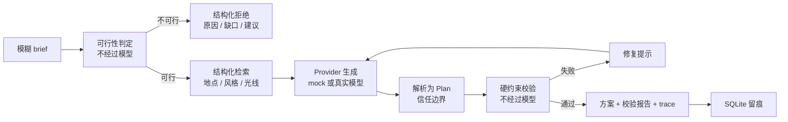

# shotplan

> 把一句模糊的「想去西安拍汉服」，变成一份**能执行、能核对、能追溯**的小时级方案。
> 这是一个可评测的 Agent 系统，不是又一个聊天框。

[English README](README.en.md) ·   

---

## 为什么做这个

大模型很擅长生成「看起来很美」的方案：一天排五个外景、妆造排在拍摄之后、景点名字是编的、预算超一倍。这类输出在 demo 里令人惊艳，在真实业务里完全不可用。

这个项目主张一件很朴素的事：**AI 应用的质量必须能被测量，而不是靠感觉。** 所以它没有把「生成」当作终点，而是在生成之前先判断需求是否可满足、在生成之后加一层不依赖模型的硬约束校验器，把「可执行」写成可测试的规则；再用一套带**对照组**的评测集，证明这套测量确实能区分好方案和坏方案。

场景选的是汉服旅拍，因为约束足够真实：光线有时段、景点之间要转场、妆造必须先于拍摄、预算是硬上限、天气要有备选。而且这个领域的好坏，人是能判断的——这是定义「什么算好结果」的前提。

## 和常见 AI Demo 的区别

| | 常见做法 | 本项目 |
| --- | --- | --- |
| 输出 | 自由文本 | 结构化 `Plan`，带时间块、成本、引用 |
| 质量保证 | 换 prompt 碰运气 | 12 条确定性规则 + 分项打分 |
| 需求不可行 | 硬凑一份方案 | 生成前判定，返回原因、缺口、修改建议与理论下限 |
| 出错处理 | 重新生成一次 | 校验报告转成修复提示，且**拒绝接受更差的结果** |
| 可验证性 | 截图 | 36 个评测用例 + 故意犯错的对照组 + CI 阈值 |
| 溯源 | 无 | 每个时间块引用知识库条目，编造地点会被拦截 |
| 运行记录 | 无 | 每次运行保存完整 trace、耗时、token 与估算成本 |
| 运行门槛 | 需要 API key | 核心零依赖，`git clone` 后直接可跑 |

## 快速开始（不需要账号、网络或 API key）

```bash
git clone https://github.com/zhaozilong6666/shotplan.git
cd shotplan
python -m shotplan.cli plan          # 生成一份完整方案 + 校验报告 + 追踪
python -m evals.run_eval --write-report   # 跑评测集并生成 docs/eval-report.md
```

如果没安装包，`python -m shotplan.cli` 需要 `PYTHONPATH=src`，或者执行 `python -m pip install -e ".[api,dev]"`（推荐，会同时装好 Web 与测试依赖）。

示例输出（节选）：

```
方案 plan_a1b2...  |  xian  2026-10-04  |  provider=mock
------------------------------------------------------------------------------
  12:00-14:05  makeup  唐制妆造               indoor_studio          400 元
  14:05-14:25  travel  转场至大雁塔北广场     big_wild_goose_pagoda   50 元
  14:25-16:02  shoot   大雁塔北广场拍摄       big_wild_goose_pagoda    0 元
  16:02-16:22  travel  转场至西安城墙         city_wall                0 元
  16:22-18:00  shoot   西安城墙拍摄           city_wall              420 元
------------------------------------------------------------------------------
  总花费 870 元 / 预算 1500 元
  得分 0.975  硬约束 通过
```

## 一次运行发生了什么



关键点：**可行性判定与校验器都在模型之外**。模型可以换、prompt 可以改，但「什么算可执行」的定义不变，因此质量可以跨版本比较。详见 [ADR 0002](docs/adr/0002-validator-outside-model.md) 与 [ADR 0007](docs/adr/0007-feasibility-before-generation.md)。

## 硬约束校验器

规则集中定义在 `src/shotplan/domain/constraints.py`，校验器、评测打分器、文档和 `/api/rules` 共用同一份定义。

| 类别 | 规则 | 级别 |
| --- | --- | --- |
| 时间 | 时间块不重叠、总时长不超限 | 硬 |
| 流程 | 必须含妆造与拍摄，且妆造在拍摄之前 | 硬 |
| 空间 | 跨地点拍摄间至少 20 分钟转场 | 硬 |
| 预算 | 总花费不超过预算（取声明值与时间块求和的较大者） | 硬 |
| 溯源 | 地点 id 必须存在于知识库，拦截编造 | 硬 |
| 质量 | 拍摄块时长、黄金光线利用、备选方案、引用数量、风格匹配 | 软 |

完整规则表：`python -m shotplan.cli rules` 或 `docs/problem-and-metrics.md`。

## 生成前：需求不可满足时明确拒绝

有些 brief 在数学上不可能满足：预算低于最低可执行成本、时长短于「妆造 → 转场 → 拍摄」最短闭环、城市不在知识库、必去与排除互相矛盾。这类请求**不会调用模型**，直接返回结构化说明：

```bash
python -m shotplan.cli plan --budget 100
# [BUDGET_BELOW_MINIMUM] 预算 100 元低于最低可执行方案成本 350 元
#   缺口：还差 250 元
#   建议：把预算提高到至少 350 元，或改用最简妆造套餐与免费场景
```

CLI 退出码 `3`；API/JSON 返回 `status: "infeasible"` 与 `feasibility` 字段；Web 界面渲染专门的不可行视图。理论下限（350 元 / 1.5 小时）从知识库动态计算，详见 [ADR 0007](docs/adr/0007-feasibility-before-generation.md)。

## 评测：一个带控制组的实验

只对自己写的 planner 跑评测，很容易写出一套永远给满分的评分器。所以评测集会在**完全相同的 36 个用例**上跑两个 provider：

| 指标 | 规则 Agent (`good`) | 对照基线 (`naive`) |
| --- | ---: | ---: |
| 硬约束通过率 | **100%** | 16.7% |
| 平均得分 | **0.9811** | 0.3250 |
| 用例通过 | **36 / 36** | 6 / 36 |

差值 **0.6561** 分说明校验器和打分器确实在测量真实差异。`naive` 会故意忽略时间、转场、预算、溯源并编造地点；如果它也能拿到高分，CI 会判定「测量失效」并直接失败——这条检查写在 `evals/run_eval.py` 里。

36 个用例分四组：`normal` 13、`conflict` 10、`edge` 7、`infeasible` 6。最后一组描述的是**数学上不可满足**的 brief，正确行为是结构化拒绝而非硬凑方案；因为可行性判定在生成之前且不确定于 provider，两组在这 6 个用例上同分，区分度由其余 30 个用例提供。

```bash
python -m evals.run_eval --write-report                            # 生成本次报告
python -m evals.run_eval --compare evals/baselines/v2-naive.json  # 与当前基线对比
python -m evals.run_eval --prompt-version planner-v1              # 记录 prompt 版本
python -m evals.run_eval --min-score 0.85                         # 提高回归门槛
```

报告由代码生成并随仓库提交（[docs/eval-report.md](docs/eval-report.md)），包含分组结果、逐用例明细、不可满足需求识别、成本/延迟（P50/P95、token）与阈值结论——招聘方不用跑代码就能看到结论。方法论见 [docs/evaluation.md](docs/evaluation.md)。

## 三份额外证据

光有评测分数还不够，这个仓库另外提供三块可核查的材料：

1. **[修复循环实验](docs/repair-experiment.md)** —— 三种刻意构造的 provider 跑同一批 30 个可满足 brief：`repairable` 一次修复把硬约束通过率从 0% 拉到 100%（30/30）；忽略修复提示的 `naive` 有 30 次候选被拒绝；「越修越差」的 `regressing` 30 次全被单调保护拦下，均分不降。每次接受/拒绝都读 trace 里的 `accepted` 字段，不靠推断。
2. **[失败案例库](docs/failure-gallery.md)** —— 170 条结构化记录、4 类硬约束违规，每条包含输入 brief、观察到的输出片段、期望规则与修复建议。新增规则之前先在这里找证据；接真实模型后按同样格式追加新错误。
3. **[运行统计面板](docs/observability.md)** —— `python -m shotplan.cli stats`、`GET /api/stats` 与 Web「运行统计」标签页，按 provider / prompt 版本聚合通过率、均分、P50/P95 延迟、成本、修复轮次与不可行数量。数据直接来自 SQLite 里每次运行的完整 payload，不维护第二份指标表。

## 架构与目录

```
shotplan/
├── src/shotplan/
│   ├── domain/        # 纯数据结构、规则与生成前可行性判定（零 I/O、零框架）
│   ├── knowledge/     # 人工整理的地点 / 风格知识库 + 检索工具
│   ├── agents/        # provider、版本化 prompt v1/v2、解析器、校验器
│   ├── pipeline.py    # 编排：可行性 → 检索 → 生成 → 解析 → 校验 → 修复
│   ├── tracing.py     # 耗时 / token / 成本 / 事件
│   ├── storage.py     # SQLite 运行历史
│   ├── observability.py # 按 provider / prompt 版本聚合运行质量
│   ├── api.py         # 可选 FastAPI 层
│   └── cli.py         # 命令行入口
├── web/               # 无构建步骤的原生单页界面（5 个视图）
├── evals/             # 36 个用例、打分器、报告、基线、修复实验、失败案例库
├── tests/             # 102 个单元测试，逐条覆盖规则与边界
└── docs/              # 架构、指标、7 份 ADR、运维、面试笔记
```

核心引擎只用 Python 标准库；FastAPI / pytest / ruff 都是可选层。这个分层让「没有 key 也能完整跑通」成为设计，而不是妥协。

## 技术取舍（ADR）

| 编号 | 决策 | 一句话理由 |
| --- | --- | --- |
| [0001](docs/adr/0001-core-zero-dependency.md) | 核心域不依赖 pydantic / 任何框架 | 保证零门槛可运行，框架校验放在 API 边界 |
| [0002](docs/adr/0002-validator-outside-model.md) | 校验器不经过模型 | 质量定义必须稳定，才能跨模型、跨 prompt 比较 |
| [0003](docs/adr/0003-exact-retrieval-over-vectors.md) | 精确检索而非向量库 | 知识库小、约束需精确匹配、每条都要可引用 |
| [0004](docs/adr/0004-versioned-prompts.md) | prompt 视为代码，带版本与变更记录 | 质量退化要能归因到具体改动 |
| [0005](docs/adr/0005-no-frontend-framework.md) | 前端不用 React / 无构建步骤 | 把复杂度预算留给 Agent 逻辑 |
| [0006](docs/adr/0006-scoring-determinism.md) | 评分固定精度 + 精确求和 | 同一输入在 3.10–3.13 上必须逐位一致 |
| [0007](docs/adr/0007-feasibility-before-generation.md) | 可行性判定在生成之前 | 「能不能做」是算术问题，不该交给模型 |

## 可选：接真实模型、启动界面、部署

```bash
cp .env.example .env
# 编辑 .env：SHOTPLAN_PROVIDER=openai_compatible 并填入 API key
python -m pip install -e ".[api,dev]"
python -m shotplan.cli serve          # 打开 http://127.0.0.1:8000
```

任何 OpenAI 兼容端点都可用（OpenAI、DeepSeek、本地 Ollama / vLLM）。不填 key 时全部功能仍可在 `mock` 模式下运行。

Docker：

```bash
docker compose up --build          # http://127.0.0.1:8000
```

界面内置「规则 Agent / 对照基线」切换，可以直观看到同一份需求下，不可执行的方案被逐条标红；把预算改到 100 元则能看到结构化拒绝视图。

## 长期路线图

项目按数周到两个月的周期持续打磨，分五个阶段，每阶段都有可验证的产出。完整清单见 [docs/ROADMAP.md](docs/ROADMAP.md)：

- [x] 阶段 1：领域模型、知识库、校验器、离线 provider、CLI
- [x] 阶段 2：pipeline、trace、SQLite、API、Web 界面
- [x] 阶段 3：评测集、对照基线、自动报告、CI 阈值
- [ ] 阶段 4：离线部分已完成（36 用例、`INFEASIBLE`、prompt v1/v2、成本/延迟、修复实验、失败案例库），待接真实模型做对比实验
- [ ] 阶段 5：可观测面板与英文 README 已完成；待在线 Demo 部署、简历与面试材料定稿

## 已知限制（写在前面，不藏）

- 知识库是人工整理的小样本，不是实时商家/票价数据；`docs/adr/0003` 解释了为什么这样选。
- 可行性下限（350 元 / 1.5 小时）来自静态知识库的理论计算，不含实时票价、闭馆、天气与档期。
- 离线 `good` provider 是**按规则写的确定性实现**，它代表当前规则下的上限参考。评测体系真正的压力测试，发生在接入真实模型（阶段 4）之后；现阶段 `naive` 对照组负责给出下限。
- 报告里的成本/延迟维度在离线模式下估算成本恒为 0，只验证可观测链路；真实模型性价比对比尚未实测。
- 尚未支持多城市、真实预约/支付、用户鉴权与并发写入。
- token 成本是估算值，只用于运行追踪，不是账单。

## 面试怎么讲

> 「我做了一个旅拍方案 Agent。核心不是调模型，而是先把『一份能执行的方案』写成 12 条可测试的硬约束，再在生成之前判断需求到底可不可满足；生成之后用不经过模型的校验器打分，把报告反馈给模型做修复，并且拒绝接受更差的结果。为了让质量可比较，我建了 36 个用例的评测集和一个故意犯错的对照 provider——CI 里如果对照组分数追上正式方案，就说明评测失效，直接失败。」

深挖问答（为什么不把判定交给模型、怎么处理幻觉、怎么定义指标、修复循环如何避免回归）见 [docs/interview-notes.md](docs/interview-notes.md)。

## 需要你本人动手的事

GitHub 建仓与推送已用本机已登录凭证完成；现在只剩**简历表述**（以及可选的 API key、部署账号）。分步手册见 [docs/USER_TASKS.md](docs/USER_TASKS.md)。

## License

MIT
