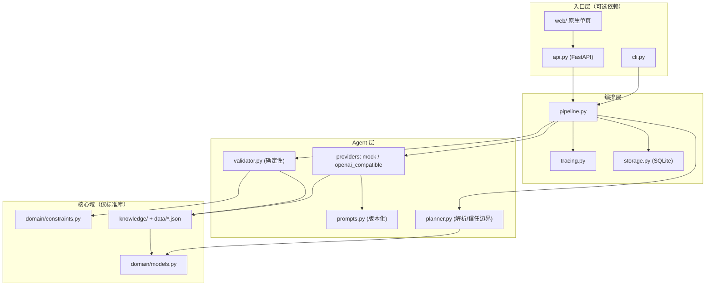

# 架构说明

## 设计目标

1. **零门槛可运行**：`git clone` 之后不需要账号、网络、API key 就能跑完整个链路与评测。
2. **质量定义独立于模型**：换模型、改 prompt 不应改变「什么算可执行」。
3. **每次运行都可追溯**：输入、输出、校验结论、耗时、成本全部留痕。
4. **复杂度预算给 Agent 逻辑**，而不是给框架和构建链。

## 分层

依赖方向严格单向向下：核心域不知道 HTTP、不知道 SQLite、不知道模型。这样单元测试可以直接测规则，不需要起服务或 mock 网络。

## 一次请求的完整数据流

1. `PlanRequest.normalized()` 把模糊输入规范化并夹紧到合法区间（时长 1–12 小时、预算 ≥ 0）。
2. `KnowledgeTools.context_for()` 做结构化检索，产出**紧凑、可引用**的上下文：候选地点、风格详情、黄金光线窗口、室内兜底、转场最短时长。
3. `PlanProvider.generate()` 返回原始 payload。真实 provider 走 urllib 调 OpenAI 兼容接口；离线 provider 用确定性规则生成。
4. `parse_plan()` 是信任边界：抽取 JSON（容忍 markdown 围栏和前后解释）、校验字段、统一时间格式、按时间排序、计算成本。任何不合法都抛 `ParseError`。
5. `validate()` 执行 12 条规则，产出问题清单、5 个维度分与加权总分。
6. 若存在硬约束问题且还有修复轮次，`build_repair_hint()` 把报告转成精确修复指令再生成一次。**只有当新草稿严格更优时才替换**，避免修复把方案改坏。
7. `TraceCollector` 汇总每步耗时 / token / 成本；`RunStore` 把完整结果写入 SQLite。

## 关键不变量

- 校验器与打分器读的是同一份 `constraints.py`，不存在两套质量标准。
- `total_cost_cny` 与所有时间块成本之和取较大者参与预算判定，防止模型在总计字段上低报。
- 修复循环单调不降：`(hard_pass, score)` 字典序比较，只有严格变大才接受。
- 任何 `location_id` 都必须在知识库中存在（travel 块允许 `-` 占位），否则判硬失败。
- 评测集同时跑 `good` 与 `naive`，若两者均分接近则判定测量失效。

## 依赖策略

| 层 | 依赖 |
| --- | --- |
| `domain/`、`knowledge/`、`agents/`、`pipeline.py`、`tracing.py`、`storage.py`、`cli.py` | 仅 Python 标准库 |
| `api.py` | `fastapi`、`uvicorn`（`[api]` extra） |
| `tests/`、`evals/` | `pytest`、`httpx`、`ruff`（`[dev]` extra） |
| `web/` | 无构建、无 npm、无 CDN |

`urllib` 而非官方 SDK 调模型，是为了让超时、重试、错误映射和响应结构都显式可见；代价是要自己处理兼容端点的差异，代码里对 `response_format` 做了降级重试。

## 扩展点

- **新 provider**：实现 `PlanProvider` 协议的 `generate()`，在 `agents/__init__.py` 的工厂里注册。
- **新规则**：在 `constraints.py` 加 `RULES` 条目 + 常量，在 `validator.py` 加检查，补一条单元测试，评测集自动生效。
- **新城市**：往 `knowledge/data/locations.json` 加一个 city 对象，`KnowledgeTools` 无需改代码。
- **新指标**：在 `constraints.py` 的 `SCORE_WEIGHTS` 加维度（总和必须为 1，`test_validator.py` 会检查）。

## 明确不做的事

向量数据库、多 Agent 辩论、任务队列、用户系统、支付。这些都会让「质量是否可测量」这个核心问题失焦。理由见 [ADR 0003](adr/0003-exact-retrieval-over-vectors.md) 与 [ADR 0005](adr/0005-no-frontend-framework.md)。
