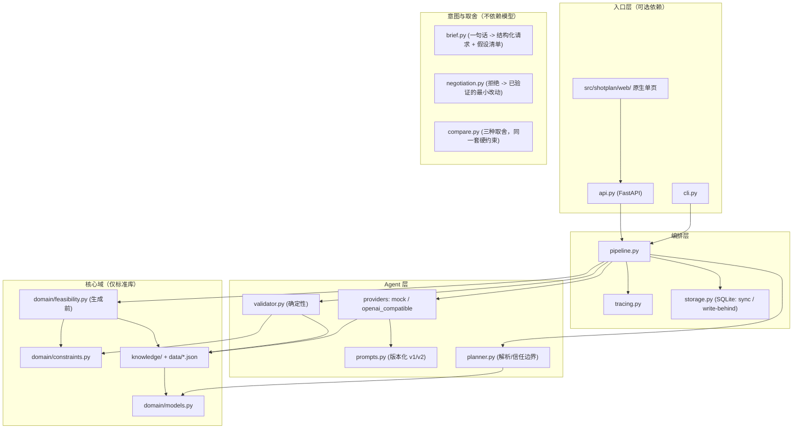

# 架构说明

## 设计目标

1. **零门槛可运行**：`git clone` 之后不需要账号、网络、API key 就能跑完整个链路与评测。
2. **质量定义独立于模型**：换模型、改 prompt 不应改变「什么算可执行」「什么算可满足」。
3. **每次运行都可追溯**：输入、输出、校验结论、耗时、成本全部留痕。
4. **复杂度预算给 Agent 逻辑**，而不是给框架和构建链。

## 分层

依赖方向严格单向向下：核心域不知道 HTTP、不知道 SQLite、不知道模型。这样单元测试可以直接测规则，不需要起服务或 mock 网络。

## 一次请求的完整数据流

流水线本身写成一张状态表（`STAGES`）：图与逐节点契约由代码生成，见 [pipeline-contract.md](pipeline-contract.md)。每一步的失败转移与降级方式都在那张表里，不靠读语句顺序推断。

0. `check_feasibility()` 在**调用 provider 之前**判断 brief 是否可能满足。不可行时直接返回 `status="infeasible"` + 结构化原因，trace 只记录 `preflight`，不生成、不修复。
1. `PlanRequest.normalized()` 把模糊输入规范化并夹紧到合法区间（时长 1–12 小时、预算 ≥ 0）。
2. `KnowledgeTools.context_for()` 做结构化检索，产出**紧凑、可引用**的上下文：候选地点、风格详情、黄金光线窗口、室内兜底、转场最短时长。
3. `PlanProvider.generate()` 返回原始 payload。真实 provider 走 urllib 调 OpenAI 兼容接口，并按版本取系统提示词；离线 provider 用确定性规则生成。
4. `parse_plan()` 是信任边界：抽取 JSON（容忍 markdown 围栏和前后解释）、校验字段、统一时间格式、按时间排序、计算成本。任何不合法都抛 `ParseError`。
5. `validate()` 执行 16 条规则（11 硬 + 5 软），产出问题清单、5 个维度分与用 `math.fsum` 聚合的加权总分。
   - 校验之前，`grounding.sanitize_source_refs()` 先丢弃无法解析的引用，并把丢弃数量写进 `validate` 阶段的 trace（`dropped_source_refs`）。直接调用 `validate()` 时伪造引用仍是硬失败（ADR 0016）；流水线选择「降级为缺失」而不是让一条坏指针毁掉整份方案，但不再静默处理。
   - 校验后若出现 `LIGHT_MISUSE`，`light.align_light_window()` 再试一次**纯代码的光线排程**：把整条时间轴整体平移，让最后一段外景落进黄金窗口，总时长与活动顺序不变。只有对齐后 `(hard_pass, score)` 不劣化才采纳。真实模型 80 例实测里 `LIGHT_MISUSE`（soft）占全部问题 47 条中的 31 条，说明「让模型排光线」本身就是错的分工。
   - 若用户明确要求「上午收工」，黄金窗口空着是**正确**结果：校验器与对齐器共用 `constraints.wants_morning_finish()`，不会为了凑光线而违背 brief。
6. 若存在硬约束问题且还有修复轮次，`build_repair_hint()` 把报告转成精确修复指令再生成一次。**只有当新草稿严格更优时才替换**，避免修复把方案改坏。
7. `TraceCollector` 汇总每步耗时 / token / 成本。运行历史有两种写入策略，共用同一张表：`RunStore` 同步提交（默认，响应返回前已落库）；`RunWriter` 交给进程内单写线程批量提交，`flush()` 才是「已落库」的屏障（ADR 0012）。
8. `explain.explain_plan()` 在终态之外补一层**可核对**的排期理由：逐拍摄块回读风格标签、NOAA 黄金窗口覆盖分钟数、点名要求、室内/人流/天气证据。它是纯函数，不调用模型，也不写回 `Plan`，因此不会污染模型输出或历史快照。

## 关键不变量

- 校验器与打分器读的是同一份 `constraints.py`，不存在两套质量标准。
- 可行性判定、校验器、光线排程都**不经过模型**；这是三个独立的「不交给 AI」判断点（ADR 0002、ADR 0007，光线排程见 `light.py`）。模型负责措辞与取舍，代码负责黄金时段——当前用 NOAA 近似按各城市经纬度算当地日落，取日落前 120 分钟（`solar.py`，UTC+8）；足以区分北京与成都并挪走 11:00 的外景，但未建模地形、天际线与更精细的大气折射，不是天文级日落。缺坐标的城市回退到月级季节表。
- `total_cost_cny` 与所有时间块成本之和取较大者参与预算判定，防止模型在总计字段上低报。
- 修复循环单调不降：`(hard_pass, score)` 字典序比较，只有严格变大才接受。
- 任何 `location_id` 都必须在知识库中存在（travel 块允许 `-` 占位），否则判硬失败。
- `must_include` 与 `avoid` 是硬规则，不只是检索提示：必去地点必须出现在拍摄块里，排除地点不得出现在任何时间块里。
- `source_refs` 必须解析到知识库中的地点或风格；伪造引用是硬失败。
- 每次运行都记录知识库与规则指纹（`kb_version` / `rules_version`）以及请求级配置快照（修复次数、墙钟预算、模型、持久化模式）；改数据或改规则后，历史分数仍可解释。
- 知识库每个地点/风格条目都带 `source` 与 `last_verified_at`；加载器校验非空与 ISO 日期，测试在「超过一年未复核」时失败。`knowledge_version` 仍是整份数据的内容指纹。
- 配置在 API 启动时解析一次（`app.state.settings`）并注入；请求 ID 中间件为每个响应回传 `X-Request-ID`，访问日志只记 method / path / status / duration，不记请求体与 key。CORS 默认关闭，自带界面与 API 同源。
- 公开部署的保护是可选层：设置 `SHOTPLAN_API_KEY` 后，`/api/plan`、`/api/runs*`、`/api/summary`、`/api/stats` 都需要 `X-API-Key`；`/api/health`、`/api/config`、`/api/rules` 保持公开（只含版本、脱敏配置与规则说明，不含运行数据）。内置 Web 面板不发送该头，因此受保护部署应改用独立前端或把 key 留在反向代理层；限流是进程内尽力而为，多 worker 下不共享计数。
- 评分用 `math.fsum` + 固定 6 位精度，跨 Python 3.10–3.13 逐位一致（ADR 0006）。
- 不可行结果同样写入运行历史，且 `status` / `feasibility` 会随 JSON 一起返回给 CLI、API 与 Web。
- 一次请求的墙钟受 `SHOTPLAN_PIPELINE_BUDGET_S` 约束：超预算停止开启新的修复轮次，返回当前最优草稿并记 `REPAIR_BUDGET_EXCEEDED`，不丢弃已算出的结果。
- 解析层是唯一允许「修」模型输出的地方，且每次修复都写进 trace 的 `notes`；数字读不出就 `ParseError`，绝不默认成 0（否则预算规则会对超支方案判通过）。
- 评测集同时跑 `good` 与 `naive`：均值接近、对照组分数异常升高，或对照组不再命中某条已知缺陷，都判定测量失效。门禁实现只有 `evals.scorers.eval_gate_problems` 一处，并由 `evals/mutation_lab.py` 注入受控故障反向验证（ADR 0009）。

## 依赖策略

| 层 | 依赖 |
| --- | --- |
| `domain/`、`knowledge/`、`agents/`、`pipeline.py`、`tracing.py`、`storage.py`、`cli.py` | 仅 Python 标准库 |
| `api.py` | `fastapi`、`uvicorn`（`[api]` extra） |
| `tests/`、`evals/` | `pytest`、`httpx`、`ruff`（`[dev]` extra） |
| `src/shotplan/web/` | 无构建、无 npm、无 CDN |

`urllib` 而非官方 SDK 调模型，是为了让超时、重试、错误映射和响应结构都显式可见；代价是要自己处理兼容端点的差异，代码里对 `response_format` 做了降级重试。

## 扩展点

- **新 provider**：实现 `PlanProvider` 协议的 `generate()`，在 `agents/__init__.py` 的工厂里注册；真实模型 provider 可传 `prompt_version` 选择 v1/v2。
- **新规则**：在 `constraints.py` 加 `RULES` 条目 + 常量，在 `validator.py` 加检查，补一条单元测试，评测集自动生效。
- **新城市**：往 `knowledge/data/locations.json` 加一个 city 对象即可，`KnowledgeTools`、前端下拉（`/api/catalog`）和一句话解析（城市别名从知识库动态生成）都会自动跟上；可行性下限按新知识库重算。历史/诗意别名（如「金陵」）才需要改 `brief.py` 的 `EXTRA_CITY_ALIASES`。
- **新指标**：在 `constraints.py` 的 `SCORE_WEIGHTS` 加维度（总和必须为 1，`test_validator.py` 会检查）。
- **运行统计**：`observability.py` 读取 `RunStore.stats_rows()` 的轻量列（provider / prompt / status / score / duration / cost / repairs），只对 `status=ok` 计算质量指标，新增维度只需改 `_summarise()`，不需要额外埋点表。
- **新不可行条件**：在 `feasibility.py` 加一条 `FeasibilityIssue`，补测试与一个 `infeasible` 组用例。

## 明确不做的事

向量数据库、多 Agent 辩论、任务队列、用户系统、支付。这些都会让「质量是否可测量」这个核心问题失焦。理由见 [ADR 0003](adr/0003-exact-retrieval-over-vectors.md) 与 [ADR 0005](adr/0005-no-frontend-framework.md)。
