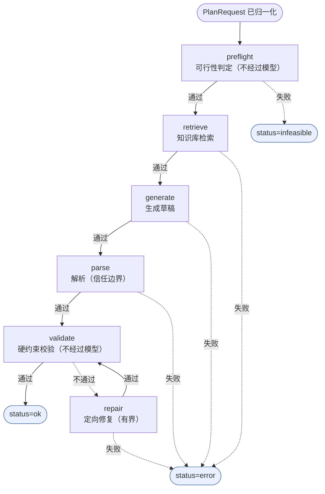

# 流水线契约：状态、输入输出与失败降级

> 由 `python scripts/build_pipeline_doc.py --write` 从 `src/shotplan/pipeline.py` 的 `STAGES` 生成。**不要手改**：CI 会比对生成结果与本文，漂移即失败。

## 先说清楚这是什么、不是什么

这是一个**确定性的有向流水线**，不是自由循环的 agent：每一步做什么、失败后去哪里、什么时候停，都在代码里写死。没有「模型决定下一步调哪个工具」这一层，也就没有「模型陷入死循环」这一类故障。

这个选择是刻意的：本项目要证明的是「方案可执行、质量可回归」，而不是「能自主编排工具」。多轮 tool calling 会引入一个新的不确定性来源，却不会让硬约束校验更可信。所以这里**没有 Tool Registry，也没有 Agent Executor**——不是漏了，是判断不需要。

真正需要防的「停不下来」有两种，都在下面处理：

1. **修复循环**：`max_repairs` 计数上限 + `(hard_pass, score)` 严格变优才接受；
2. **单次调用过慢**：provider 内部 3 次尝试 × 超时，叠起来可能几分钟——用**墙钟预算**兜底，超预算就带着当前最优草稿降级返回，不无限等。

## 执行链路



终态：

- **`status=ok`** —— 返回方案（hard_pass 可能为 False，已尽力修复）
- **`status=infeasible`** —— 结构化拒绝：给出原因、缺口、建议与理论下限
- **`status=error`** —— 结构化失败：status=error + PIPELINE_ERROR/DEADLINE_EXCEEDED，不抛 500

## 每个节点的契约

| 节点 | 输入 | 输出 | 成功去往 | 失败去往 | 重试 |
| --- | --- | --- | --- | --- | --- |
| `preflight` | request | feasibility | `retrieve` | `infeasible` | 否 |
| `retrieve` | request | context | `generate` | `error` | 否 |
| `generate` | request, context, repair_hint | generation | `parse` | `error` | 是 |
| `parse` | payload, request | plan | `validate` | `error` | 否 |
| `validate` | plan, request | report | `ok` | `repair` | 否 |
| `repair` | report, plan | plan, accepted | `validate` | `error` | 是 |

### `preflight` — 可行性判定（不经过模型）

- 输入：
```json
{
  "request": "PlanRequest(已归一化)"
}
```
- 输出：
```json
{
  "feasibility": "{feasible: bool, headline: str, reasons: [{code, suggestion}]}"
}
```
- 说明：纯算术与约束可满足性。不可满足时结构化拒绝，不生成注定失败的方案。

### `retrieve` — 知识库检索

- 输入：
```json
{
  "request": "PlanRequest"
}
```
- 输出：
```json
{
  "context": "{city, candidate_locations: [...], indoor_fallback: [...], light_window}"
}
```
- 说明：确定性检索，无模型参与；上下文大小直接影响 token 成本。

### `generate` — 生成草稿

- 输入：
```json
{
  "request": "PlanRequest",
  "context": "检索结果",
  "repair_hint": "str | None"
}
```
- 输出：
```json
{
  "generation": "{payload, tokens_in, tokens_out, cost_cny, duration_ms}"
}
```
- 说明：provider 内部对可重试状态码最多尝试 3 次，指数退避 0.5s / 1s。

### `parse` — 解析（信任边界）

- 输入：
```json
{
  "payload": "dict | str | bytes",
  "request": "PlanRequest"
}
```
- 输出：
```json
{
  "plan": "Plan(slots 已排序, 数值已校验)"
}
```
- 说明：可恢复的格式问题会被修复并记入 trace.notes；无法读出的数字直接 ParseError。

### `validate` — 硬约束校验（不经过模型）

- 输入：
```json
{
  "plan": "Plan",
  "request": "PlanRequest"
}
```
- 输出：
```json
{
  "report": "{issues: [...], scores: {...}, score: float, hard_pass: bool}"
}
```
- 说明：12 条硬规则 + 软评分。hard_pass=True 时直接终止，不进入修复。

### `repair` — 定向修复（有界）

- 输入：
```json
{
  "report": "上一轮校验报告",
  "plan": "当前最优草稿"
}
```
- 输出：
```json
{
  "plan": "更优草稿或保持原方案",
  "accepted": "bool"
}
```
- 说明：只在 (hard_pass, score) 严格变大时接受新草稿；受 max_repairs 与墙钟预算双重约束。

## 最坏情况延迟是可以算出来的

这些数字由代码里的常量算出来，不是拍脑袋写的：

```
单次请求的模型调用次数上限 = 1 + max_repairs                = 1 + 1 = 2
每次调用的 HTTP 尝试上限   = MAX_ATTEMPTS                   = 3
HTTP 调用总数上限          = 2 × 3 = 6
每次尝试的超时             = SHOTPLAN_LLM_TIMEOUT           = 30s
退避总和（0.5s + 1s 每轮）  = 3.0s
最坏墙钟                   = 6 × 30 + 3.0 = 183.0s
墙钟预算                   = SHOTPLAN_PIPELINE_BUDGET_S     = 60.0s
```

结论：默认配置下最坏情况约 **183.0s**，远大于预算 60.0s。所以预算**先于**重试上限生效：第 3 次 HTTP 尝试还没跑完，流水线就已经决定不再开始新的修复轮次。只数次数不设预算，等于把延迟交给「provider 有多慢」决定。

预算耗尽时不是报错退出，而是：

1. 停止开启新的修复轮次；
2. 返回**当前最优草稿**；
3. 在校验报告里追加一条 `REPAIR_BUDGET_EXCEEDED` 软问题，并在 trace 里记 `budget.exhausted=true`。

只有连第一次生成都没开始就超预算，才会返回 `status=error` + `DEADLINE_EXCEEDED`——那时没有任何可用草稿可以降级。

## 这张表怎么保证不漂移

1. **文档由代码生成**：`python scripts/build_pipeline_doc.py --check` 比对生成结果与本文，CI 里跑。改了 `STAGES` 不改文档，门禁红。
2. **运行时事件必须来自这张表**：`tests/test_pipeline_contract.py` 跑通正常、不可满足、provider 失败、解析失败、预算耗尽五条路径，断言 trace 里的每个事件名要么是声明的节点，要么是 `repair_N` / `budget`。加了步骤不声明，测试红。
3. **转移目标必须存在**：测试断言每个 `on_success` / `on_failure` 都指向已声明的节点或终态，防止拼错一个字符串就多出一条永远走不到的死路。

## 已知边界

- 预算只能**在节点之间**检查。一次已经发出的 HTTP 请求不能被预算中断，它仍然受 `llm_timeout` 约束。要做硬中断得在 provider 层加取消机制，当前没有。
- 修复轮次之间不重试「同一个草稿」：每轮都是一次新的生成，成本按轮次线性增长。
- 离线 mock provider 下这些上限都不会触发，所以预算逻辑由单测用人工时钟/极小预算覆盖，而不是靠评测集碰巧跑到。
